# Initiative: Sketchbook characters

| | |
| --- | --- |
| **Status** | Started: Snatch is in the game (#46); next is `feature/snatch-small-roller`, then `feature/sketchbook-astronaut` |
| **Phase** | P3 (the characters), P5 (prices, with the [parts catalog](robot-parts-catalog.md)) |
| **Started** | 2026-11-07 |
| **Done when** | A kid walks into the Bot Maker, opens the Characters shelf, taps Snatch, and rolls out as a gray robot cat with huge yellow eyes, pointed ears, and a ringed tail. They swap its head for Patch's pumpkin, then reach out with the cat's tail, grab a saber off the floor two meters away, and pull it into their grabber, while a friend on an iPad sees exactly that robot. |

Five characters, drawn by the owner's son: a **cat**, an **astronaut**, a **pumpkin**, a **spider**, and a
**homemade** robot. The owner turned them into a reference sheet, and that sheet is the design: **Snatch**, **Astro**,
**Patch**, **Spider Web**, and **Homemade Web**. Each one becomes a **special build** in the Bot Maker.

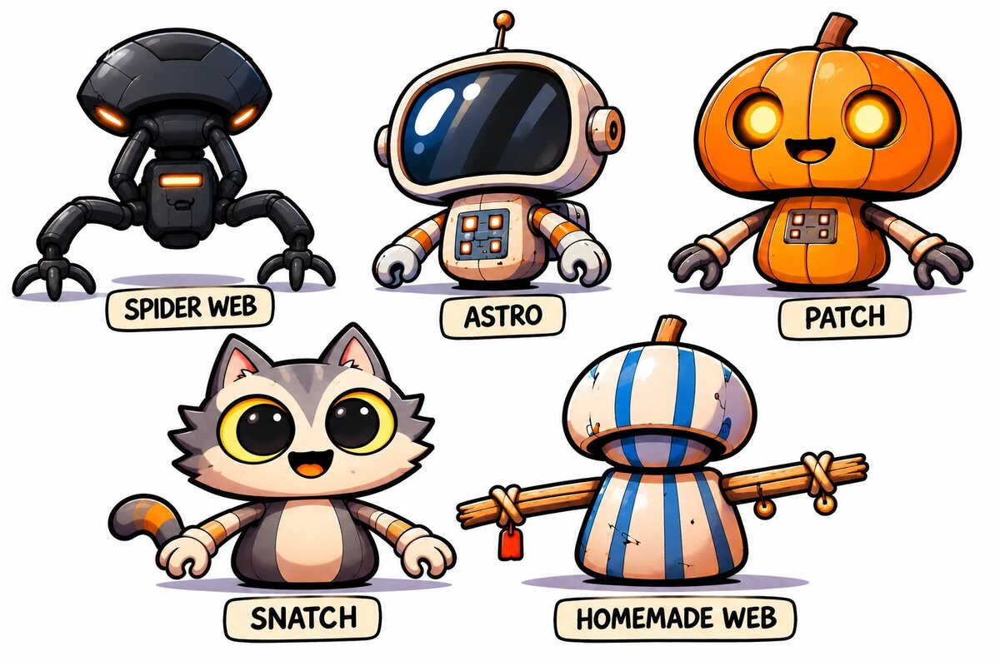

The owner then made a close-up of Snatch. Where it differs from the sheet (a small closed mouth, orange bands on the
arms, mitten paws), the close-up wins.

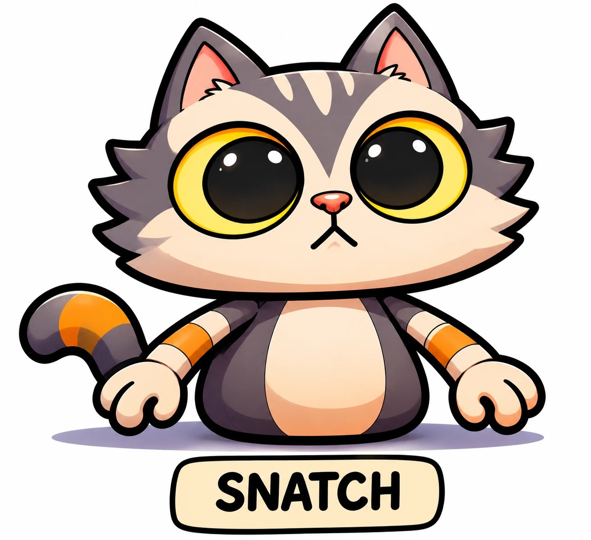

They're chunky cartoon robots: big heads on small bodies, **cel-shaded with thick black outlines**, a little scuffed.
Every head is built by **one shape generator** with the same layout (the same vertices, texture map, and feature
spots), and so is every torso; each character sets a few numbers (width, height, depth, how boxy, ribs) to get its
shape from the sheet. What else tells them apart is the **skin** and a few **features** stuck on top (ears, an antenna,
a stem, a peg, a tail).

They're still robots. Each eats carrots through a jaw and takes paint, and each rolls on a small drive roller hidden
under its body (Spider Web walks on its four legs instead).

## The drawings

| Cat | Astronaut | Pumpkin | Spider | Homemade |
| --- | --- | --- | --- | --- |
| 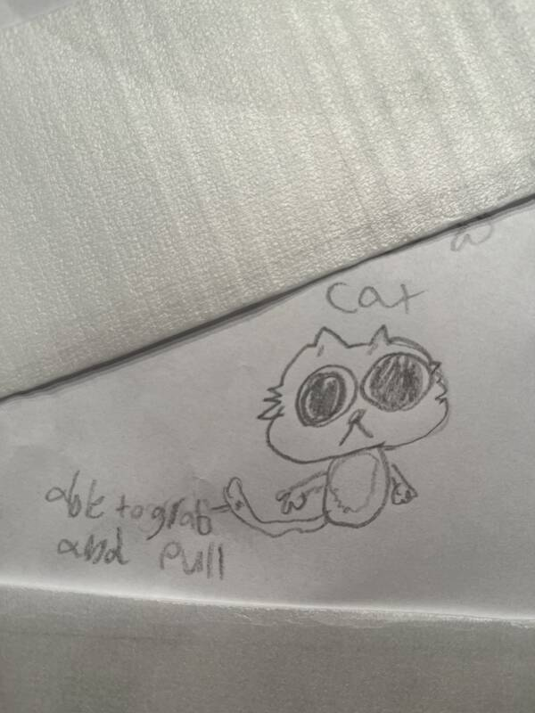 | 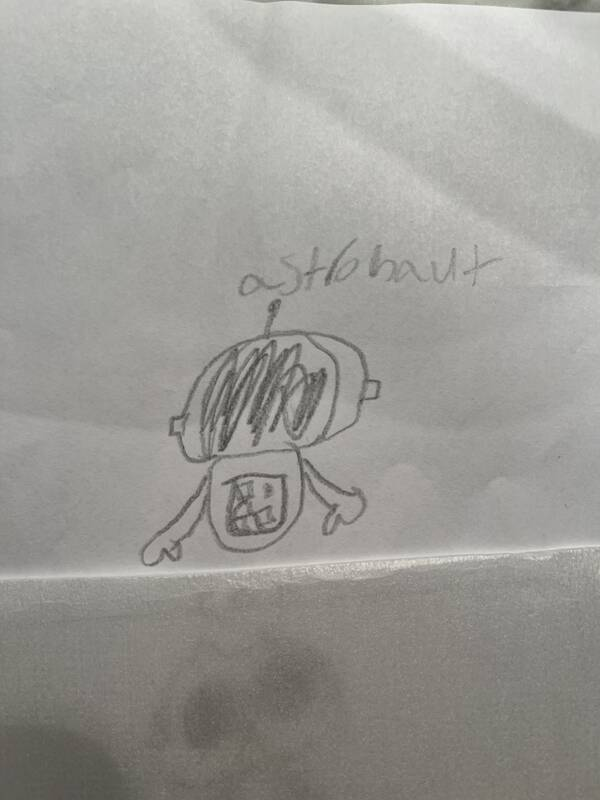 | 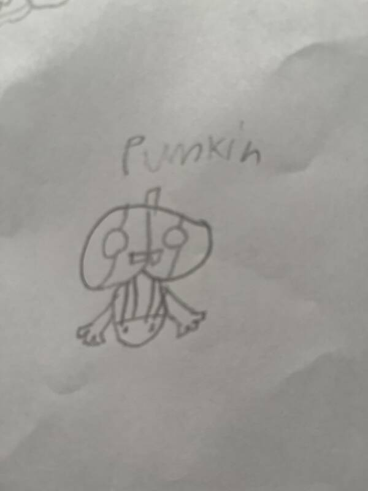 | 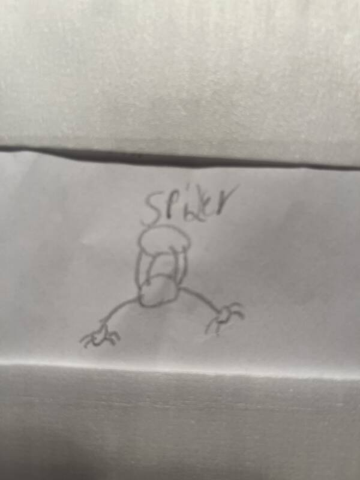 | 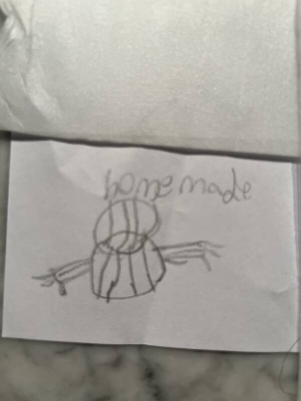 |

### In the game

Concept renders built in three.js to match the reference sheet (and Snatch's close-up), the way this doc plans to build
them: shared shape generators, toon materials on a stepped ramp, and thick outlines. They're the look to aim for.

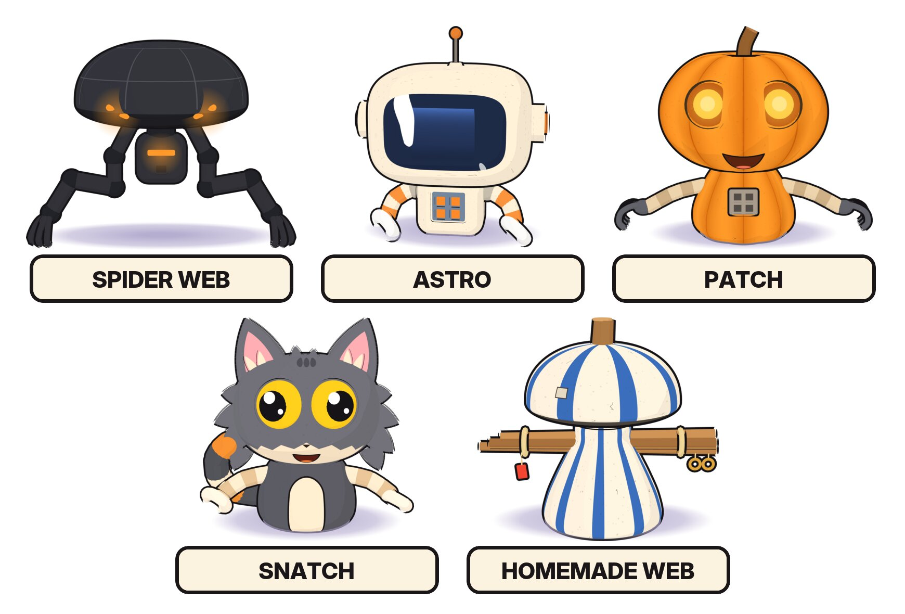

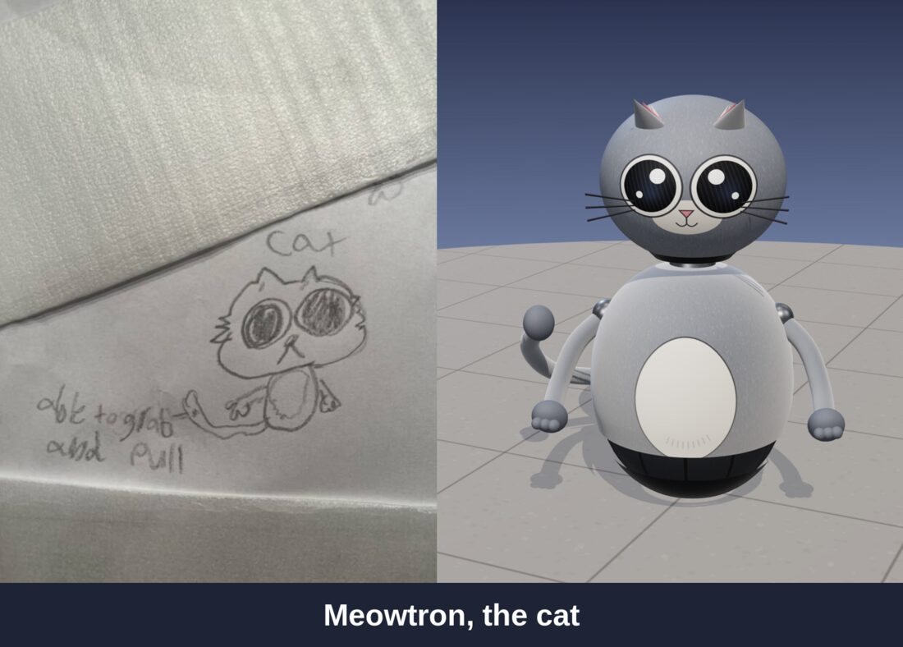
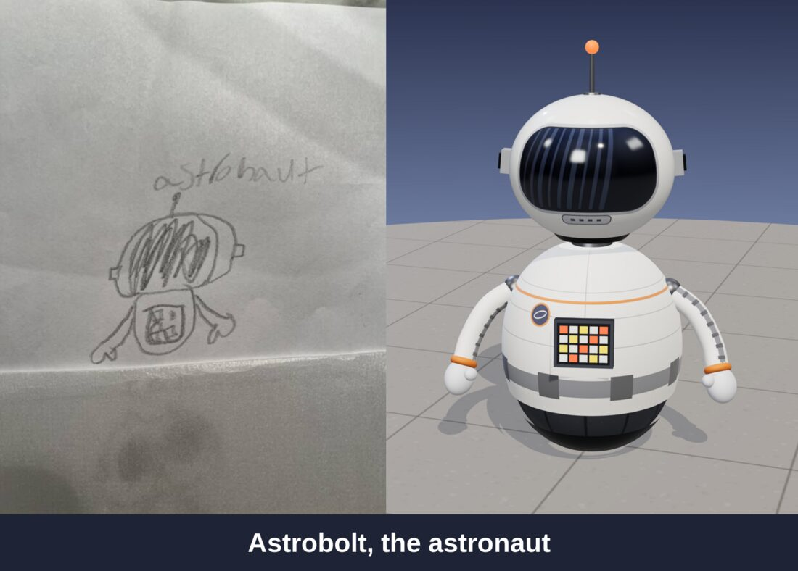
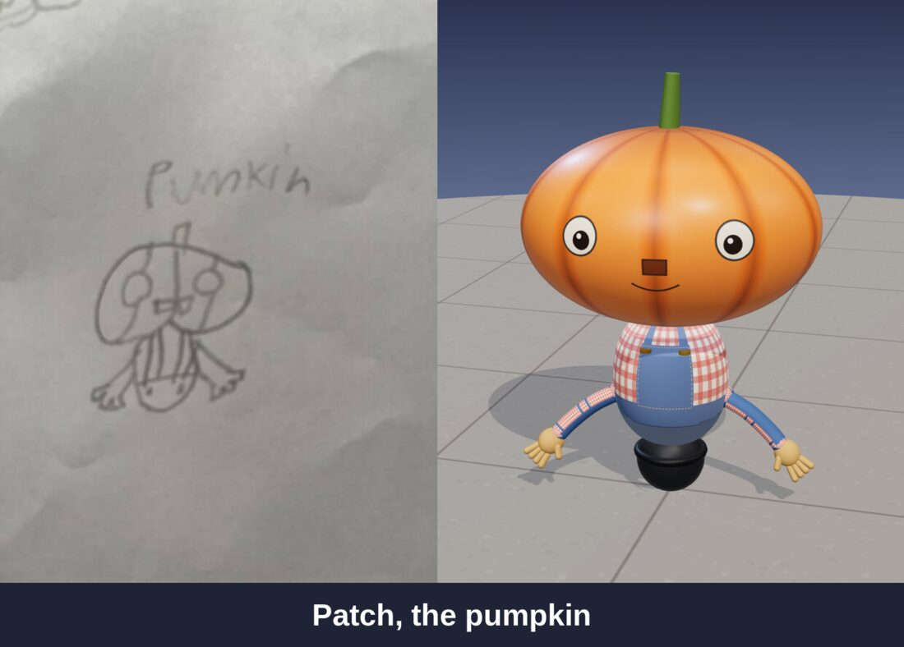
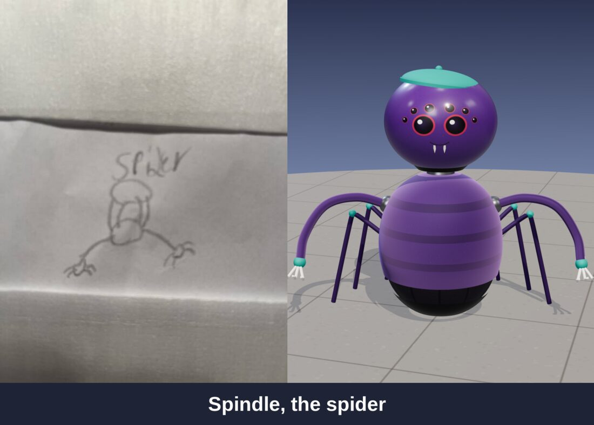
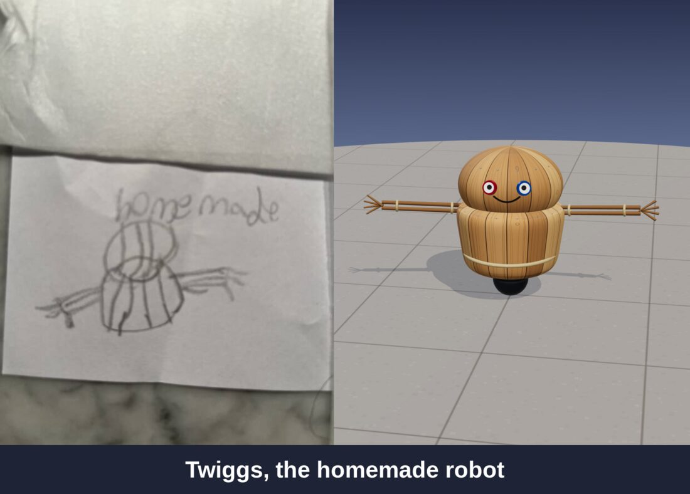

The cat's tail is labeled "able to grab and pull". That's a feature, not a look: [the tail](#the-cats-tail) has its own
PR.

## Decisions

By the owner, 2026-11-07.

- **Five characters, from the drawings:** cat, astronaut, pumpkin, spider, and homemade.
- **The reference sheet is the design.** Shapes, colors, faces, arms, and hands follow it as exactly as the game can.
  For Snatch, the close-up refines it.
- **Their names are the sheet's:** Snatch (cat), Astro (astronaut), Patch (pumpkin), Spider Web (spider), and Homemade
  Web (homemade).
- **Same torso geometry, same head geometry,** as one layout per part: one generator, one texture map, the same
  feature spots, with each character's own shape numbers.
- **Skins tell them apart,** with **features on top:** ears, antennas, stems, and the like.
- **They're a catalog** of skins and avatars in the Bot Maker, and each one is a quirky play on robots.
- **The cat's tail can grab and pull.**

### Proposed here, for the owner to confirm

- **Characters are parts, so kids can mix them.** Each character is a torso, a head, and arms, one in each of the
  `body`, `head`, and `arms` slots. Every torso has its neck spot on top and every head sits on it, so every head fits
  every torso: a pumpkin head on Astro's body just works. A character is a **preset build** on the Characters shelf,
  and one tap puts on all three parts.
- **Paint colors the main skin, not the details.** A painted Snatch is an orange cat with the same cream belly and
  yellow eyes. Visors, glowing eyes, chest panels, and the like never take paint.
- **The drawing goes on the card.** Each character's catalog card shows the sketch it came from, with a credit line.
- **Free at first,** like every part, then priced with the rest of the [parts catalog](robot-parts-catalog.md#prices):
  5 CC for each part, or 12 CC for a whole character.

## Design

### The look: cel-shaded with outlines

- **Toon materials** (`MeshToonMaterial`) on a three-step ramp, so each surface reads as flat light, mid, and shadow
  colors, like the sheet.
- **Thick black outlines** from an inverted hull: each part's mesh drawn again, pushed out along its normals, back
  faces only, in near-black. One shared outline material per thickness.
- **Lines between parts.** The close-up also draws lines across a part: between an arm's bands, between a paw's
  fingers. A hull can't draw those. Snatch's render draws every line from a part-ID pass instead: each part rendered
  in a flat id color, and a line wherever the id changes (thick around the silhouette and between parts, thin between
  bands). PR 1 picks one of the two, or a hull with the bands' lines drawn into the skin.
- **Scuffs:** cream and orange skins carry specks and a few scratches, drawn into the skin texture.
- **Glows are unlit,** not lights (D9): Patch's eyes, Spider Web's eye slits and chest slit, and Astro's chest buttons,
  with a soft sprite halo.
- The rest of the station stays as it is. The characters are the only toon-shaded things in it, which is the point:
  they're the kid's drawings come to life.

### The shared shapes

- **One generator per part.** Heads are superellipsoids: a ball stretched wide or tall, made boxier, ribbed, dimpled at
  the top, or flattened underneath, from a few numbers. Torsos are lathes from a profile, optionally ribbed. Every
  head has the same vertices, texture map, and feature spots, and so does every torso, so skins and features work the
  same on all of them. Each character's shape is built once and shared by every robot wearing it.
- **Big heads, small bodies, no neck.** The head sits right on the torso, as on the sheet. Spider Web is the exception:
  its dome rides on a short neck above its body.
- **The roller.** The characters don't sit on the giant drive sphere. Their mobility is a small drive roller hidden
  under the body, so they still roll. Spider Web stands on its claws, with its body off the floor; it rolls on the same
  hidden roller, and its legs step as it goes. PR 2 adds the roller (the `roller` mobility part):
  a small drive ball on the floor, tucked up inside the body, so the body sits just off the ground. Putting a character
  on whole puts it on its roller; any body can ride the roller, and any character can still ride the big wheel.
- **Torsos keep the standard mounts** (the neck spot on top, shoulders, the hold point, a chest hatch), placed on each
  shape, so any head and any arms fit any torso, and a character's head and arms fit the old bodies too.
- **The arms** are segmented: short capsules in two alternating colors, so the outline draws each joint. The hand on
  the end changes per character: round mitten paws (Snatch), round C-shaped grabbers (Astro), dark hooked claws
  (Patch), three-toed claw feet (Spider Web). Homemade Web has a bundle of sticks instead.
- **The jaw:** the head's jaw is one cut in the shared shape (the lower front, below the face), the same for every
  character. Each skin draws its own mouth on it: Snatch's small closed one and Patch's open grin. Homemade Web has no
  face, so its jaw is the cap's dark underside. With no head, the torso's chest hatch is the mouth, as on every body.

### Skins

- **A skin is a texture, not a shape.** Each skin is a canvas texture drawn in code (`makeCanvas`, like every robot
  skin today), cached, so every robot wearing it shares one texture.
- **Paint goes on the fur.** A skin is a layer of details over the fur color, clear wherever the fur shows: Snatch's
  face, stripes, and belly. Paint changes the fur color under it, so the details stay. The cat's parts do this in
  their own shaders (`avatar/parts/cat-look.ts`), with the same coat cure as every painted part, and the shared coat
  shader is untouched, so the classic robot and every screenshot baseline stay as they were.
- **Paint cure works the same:** a freshly painted cat is see-through over its gray fur, and the color fills in as it
  eats carrots.

### The characters

| | Head | Body | Arms and hands | Features |
| --- | --- | --- | --- | --- |
| **Snatch**, the cat | Wide head, gray on top with cream tabby stripes, a gray V down to a pink nose, and a cream face; huge yellow eyes with big black pupils and white shines; a small closed cat mouth | A dark gray bell with a cream belly | Gray at the shoulder, then cream with an orange band; round cream mitten paws with curled fingers | Big pointed ears, pink inside with cream fluff; spiky gray fur tufts on the cheeks; a thick tail, gray with an orange ring, curling up behind its left paw |
| **Astro**, the astronaut | A cream, round-cornered helmet with a big glossy navy visor and white shines | A small cream box with a slate chest panel of four lit orange squares | Cream-and-orange striped arms, round white C grabbers | Antenna with an orange ball, round ear discs with orange centers, a backpack |
| **Patch**, the pumpkin | A wide ribbed pumpkin with glowing yellow eyes in orange sockets and an open grin with a tongue | A ribbed orange bell with a small chest panel of four dark buttons | Long tan striped arms, dark gray hooked three-finger claws | A brown stem |
| **Spider Web**, the spider | A wide dark dome with panel seams, and two glowing orange slit eyes at its lower front corners | A small dark rounded box with a glowing orange slit and a little grille, on a short neck | Four legs: two thin ones from under the dome to the body's sides, two big ones out and down to three-toed claw feet | Glowing eyes and chest slit |
| **Homemade Web**, the homemade robot | A mushroom cap, cream with blue stripes and a dark underside, patched and chipped. No face | A cream bell with blue stripes | A bundle of sticks straight across, tied with rope | A wooden peg on top, brass rings hanging on the right, a red tag on the left |

**Patch and the jack-o-lantern.** The [parts catalog's jack-o-lantern head](robot-parts-catalog.md#the-jack-o-lantern-head)
is its own carved shape with a candle glow. Patch is a different part, in the sheet's toon style. Both stay. Patch's
stem can reuse the jack-o-lantern's builder if that PR lands first.

**Eyes.** Until the parts initiative splits eyes from heads (its `foundation/seven-part-slots`), each character's eyes
are part of its head. That PR then gives the shared head eye sockets, and each character's eyes become its default eye
part, so a Snatch with Patch's glowing eyes is a pick away.

### The Characters shelf

- **A new shelf in the Bot Maker,** next to the slot lists: one card per character, with its name, the drawing's word,
  a turntable of the character, and the sketch it came from.
- **Tapping a card puts on its torso, head, and arms,** each in its original skin. The rest of the build (mobility,
  and later eyes, voice, and thrusters) stays as it was.
- **Then mix:** the parts sit in the normal slot lists too ("Snatch head", "Patch body"), so any of them can be
  swapped one at a time.
- **In code,** `shared/content/characters.ts` lists the characters: id, robot name, the drawing's word, and the three
  parts. The parts are ordinary entries in `ROBOT_PARTS` (`body: cat`, `head: cat`, `arms: cat`, and so on), drawn by
  one shared builder per slot that takes the skin and features from a table.

### The cat's tail

"Able to grab and pull." The tail is a third hand.

- **Grab:** with the cat's torso on, a **Tail** button (or the grip on the other hand in VR, when that hand is empty)
  whips the tail out to grab a held item up to **2.5 m** away: a saber on the floor, a carrot on a stand.
- **Pull:** the tail curls back and pulls the item into the robot's hand, if the hand is free, or holds it behind the
  robot if it isn't. A robot can carry one item in its hand and one in its tail.
- **What it can't grab:** items another robot is holding, and anything for sale in a shop (it doesn't steal).
- **The server decides,** like every pickup: the tail's grab is the same `pickup` the hand sends, with a longer reach,
  so it waits for `foundation/server-held-items`.
- **The swish:** the tail is a chain of segments driven by a little spring, so it sways as the robot rolls, flicks on
  a turn, and curls when it stops. The swish is cosmetic and comes from the seeded `mulberry` stream, never
  `Math.random`.
- **Rates in config:** reach, how fast it whips out and pulls back, and how long between grabs.

### Protocol

- **Every new part id needs a `PROTOCOL_VERSION` bump:** an older client's `cleanRobotBuild` refuses an id it doesn't
  know, so it couldn't draw a friend's robot. Each character's PR bumps it once.
- **The tail** adds a `tail` field to the pose (out, holding, or idle) so friends see it reach, and a second held slot
  for what it holds. One more bump.
- **No database change** for the characters: they're parts in `robots.build_json`. Prices come with the parts
  catalog's `owned_parts`.

## The PRs

Each PR branches from `main`, merges on its own, and leaves the game playable. Update the status here as each one
merges.

| # | Status | Branch | PR title | What it adds | Protocol / schema |
| --- | --- | --- | --- | --- | --- |
| 1 | **Done** (#46) | `feature/sketchbook-cat` | Turn the sketchbook cat into a robot | Snatch as parts: a `cat` head, body, and arms in each slot's list, and a **From the sketchbook** pick in the Bot Maker that puts all three on (`shared/content/characters.ts`). Cel-shaded on a stepped ramp, with inverted-hull outlines. Skins drawn in code as details over the fur, so paint covers the fur only. The head: the superellipsoid with the face, eyes laid on it, the nose, ears, cheek tufts, and a jaw. The body: a bell sitting on the drive ball (the small roller came with PR 2), carrying the ringed tail in its rest pose. The arms: banded, with mitten paws. Screenshots face on, painted and not, and every classic baseline unchanged. | `PROTOCOL_VERSION` 13 |
| 2 | | `feature/snatch-small-roller` | Give Snatch a small roller so it sits close to the ground | The `roller` mobility part, **Small roller**: a little drive ball tucked up inside the body. On it, everything above sits down until the body's underside is just off the floor (each body says where its underside is), as long as the arms still hang clear. The drive ball spins by its own radius. Putting Snatch on whole puts it on the roller, in the old wheel's paint. Snatch's screenshots re-recorded. | `PROTOCOL_VERSION` 15 |
| 3 | | `feature/sketchbook-astronaut` | Turn the sketchbook astronaut into a robot | The cat's head and body made into the shared generators, with each character's shape numbers; the Characters shelf, with a card and the drawing for each. Astro: the helmet and visor, the boxy body and chest panel, striped arms and grabbers, the antenna, ear discs, and backpack. A screenshot. | `PROTOCOL_VERSION` bump |
| 4 | | `feature/sketchbook-pumpkin` | Turn the sketchbook pumpkin into a robot | Patch: the ribbed pumpkin head and body, glowing eyes, the stem, the chest panel, and hooked claws. A screenshot. | `PROTOCOL_VERSION` bump |
| 5 | | `feature/sketchbook-spider` | Turn the sketchbook spider into a robot | Spider Web: the dark dome with glowing slit eyes, the box body on its neck, and four jointed legs with claw feet that step as it rolls. A screenshot. | `PROTOCOL_VERSION` bump |
| 6 | | `feature/sketchbook-homemade` | Turn the sketchbook homemade robot into a robot | Homemade Web: the striped mushroom cap and bell, the peg, the stick bundle with rope, rings, and the red tag. A screenshot sheet of all five characters, and of a few mixed builds. | `PROTOCOL_VERSION` bump |
| 7 | | `feature/cat-tail-grab` | Let the cat's tail grab and pull things | The tail as a third hand: whip out, grab a held item up to 2.5 m away, pull it in. A `tail` pose field, a second held slot, and the server checking the reach. Needs `foundation/server-held-items`. | `PROTOCOL_VERSION` bump |

PRs 1 to 6 don't need anything else and can merge any time, in any order after PR 1. PR 7 needs the
[inventory initiative](inventory.md)'s `foundation/server-held-items`. Prices come with the parts catalog's
`feature/parts-catalog`, which lists the characters' parts with the rest.

## Tests

- **Unit:**
  - `cleanRobotBuild` with every character part, and with mixed builds (Snatch's head on Homemade Web's body).
  - Every character in `characters.ts` names parts that exist, in the right slots.
  - The tail's reach rule: in range, out of range, held by someone else, for sale in a shop.
- **Server:**
  - A tail grab past the reach is refused; two robots grabbing the same item, one with a tail, give it to one only.
- **E2E:**
  - A screenshot of each character in its original skin, one fully painted (the details stay unpainted), and the
    classic robot unchanged.
  - Picking a character on the shelf puts on all three parts (DOM-checked through the builder), and swapping one head
    leaves the rest.
  - The cat's tail pulling a carrot into its paw.

## Risks

| Risk | Mitigation |
| --- | --- |
| The paint mask changes the coat shader, and with it every painted robot | Parts without a mask take the old path (a define, not a uniform), so their shader is byte-identical, and the baselines prove it |
| Features add draw calls to every robot | Each feature is a few small meshes; merge a robot's static ones per material after it's built, as the parts catalog plans. Watch Quest frame time with 10 characters |
| Thin claws, antennas, and outlines shimmer in VR | Outlines scale with distance; check every character in the VR close-up |
| The tail's 2.5 m reach feels like stealing | It can't take what's held or for sale, and the server checks the reach |
| Outlines double the draw calls of every character | One outline mesh per merged static group, not per part; drop outlines on far-away robots |
| Toon characters look out of place in the station | They're meant to stand out; check them next to the classic robot in the plaza screenshot |
| A build drifts from the reference sheet | Each PR's screenshot goes next to the sheet in review, and the son sees it before it merges |

## Open questions

- **The credit on the cards:** "Drawn by" whom? A first name, a nickname, or just "From the sketchbook"?
- **Can the tail pull friends?** Towing a friend's robot (with their OK) is fun, but each player's client owns their own
  robot (D7), so it needs a "let them pull you" step. Left out of PR 7.
- **More characters later?** If the sketchbook keeps growing, a new character is a skin, some features, and a hand.
  Should kids be able to submit drawings from inside the game, or does the owner add them?
