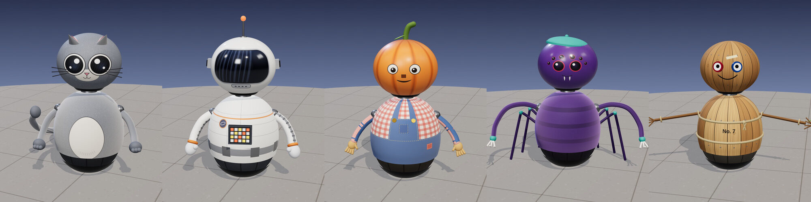

# Initiative: Sketchbook characters

| | |
| --- | --- |
| **Status** | Planned: next is `feature/sketchbook-cat` |
| **Phase** | P3 (the characters), P5 (prices, with the [parts catalog](robot-parts-catalog.md)) |
| **Started** | 2026-11-07 |
| **Done when** | A kid walks into the Bot Maker, opens the Characters shelf, taps Meowtron, and rolls out as a gray robot cat with big shiny eyes, pointed ears, and whiskers. They swap its head for Patch's pumpkin, then reach out with the cat's tail, grab a saber off the floor two meters away, and pull it into their paw, while a friend on an iPad sees exactly that robot. |

Five characters, drawn by the owner's son: a **cat**, an **astronaut**, a **pumpkin**, a **spider**, and a
**homemade** robot. Each one becomes a **special build** in the Bot Maker: a robot dressed up as the drawing.

The trick is that they share their shapes. Every character has **the same torso** and **the same head**: one
geometry each, built once. What tells them apart is the **skin** (the cat's fur, the astronaut's suit, the pumpkin's
overalls) and a few small **features** stuck on top (ears, an antenna, a stem, a tail). So five characters cost two
meshes, five sets of textures, and a handful of little add-ons.

They're still robots. Each rolls on the drive sphere like every robot on Ring Seven, eats carrots through a jaw, and
takes paint. They're robots in costume, and each has a robot name that plays on what it is.

## The drawings

| Cat | Astronaut | Pumpkin | Spider | Homemade |
| --- | --- | --- | --- | --- |
|  |  |  |  |  |

### In the game

Concept renders, one per drawing, built in three.js from the shared shapes this doc plans: one torso and one head
for all five, each in its own skin, with its own features and hands. They're a look to aim for, not the final
parts.

The cat's tail is labeled "able to grab and pull". That's a feature, not a look: [the tail](#the-cats-tail) has its own
PR.

## Decisions

By the owner, 2026-11-07.

- **Five characters, from the drawings:** cat, astronaut, pumpkin, spider, and homemade.
- **Same torso geometry, same head geometry.** Every character's torso is one shared shape, and every head is another.
- **Skins tell them apart:** the cat has a cat's body, the astronaut a space suit, the pumpkin overalls.
- **Features on top:** ears, antennas, stems, and the like, added to the shared shapes.
- **They're a catalog** of skins and avatars in the Bot Maker, and each one is a quirky play on robots.
- **The cat's tail can grab and pull.**

### Proposed here, for the owner to confirm

- **The robot names:** Meowtron (cat), Astrobolt (astronaut), Patch (pumpkin), Spindle (spider), and Twiggs (homemade).
  The catalog card shows the drawing's own word under the name: "Meowtron, the cat".
- **Characters are parts, so kids can mix them.** Each character is a torso, a head, and arms, one in each of the
  `body`, `head`, and `arms` slots. Since the shapes are shared, every head fits every torso: a pumpkin head on a space
  suit just works. A character is a **preset build** on the Characters shelf, and one tap puts on all three parts.
- **Arms too.** The drawings give each character its own hands (paws, mittens, fingers, claws, twigs), so the arms are
  a shared shape with a skin and a hand of their own, like the torso and head.
- **Paint colors the main skin, not the details.** A painted cat is an orange cat with the same white belly, dark eyes,
  and whiskers. The astronaut's visor, the overalls' buttons, and the like never take paint.
- **The drawing goes on the card.** Each character's catalog card shows the sketch it came from, with a credit line.
- **Free at first,** like every part, then priced with the rest of the [parts catalog](robot-parts-catalog.md#prices):
  5 CC for each part, or 12 CC for a whole character.

## Design

### The shared shapes

Built once each and reused by every character, so the GPU holds one copy of each, however many robots wear them.

- **The torso:** an egg-shaped shell over the top of the drive sphere, a little narrower at the shoulders, like the
  round bellies in the drawings. It has the rust ball's mounts (neck height, shoulders, and the hold point), so any
  head and any arms fit it, and a character's head and arms fit the old bodies too.
- **The head:** big and round, a little wider than tall (about 0.85 by 0.75), since every drawing gives its character
  a big round head. It sits on the same short neck as the big-eye dome.
- **The arms:** a soft, round-ended tube from the shoulder that hangs and swings like the noodle arms, with a **hand**
  on the end. The hand changes per character: there are five hands, and the arm is one shape.
- **The jaw:** the head's jaw is one cut in the shared shape (the lower front, below the face), the same for every
  character. Each skin draws its own mouth on it: the cat's little "ω", the pumpkin's grin, the astronaut's chin plate.
  If there's no head, the torso's chest hatch is the mouth, as on every body.
- **Feature anchors:** named spots on the shared shapes where features attach: `top`, `left` and `right` on the head,
  and `front`, `back` and `sides` on the torso.

### Skins

- **A skin is a texture, not a shape.** Each skin is a canvas texture drawn in code (`makeCanvas`, like every robot
  skin today), cached, so every robot wearing the cat skin shares one texture. Skins are drawn bold and simple, like
  the drawings, with soft pencil-gray outlines around the big shapes (the belly, the visor, the straps) as a nod to
  where they came from.
- **A paint mask.** Each skin has a second texture marking what paint covers. The coat shader (`avatar/parts/kit.ts`)
  mixes by `cure × mask` instead of `cure`. Parts without a mask draw as before, so the classic robot and every
  screenshot baseline stay unchanged.
- **Paint cure works the same:** a freshly painted cat is see-through over its gray fur, and the color fills in as it
  eats carrots.

### Features

Small meshes on the anchors, each a builder in `avatar/parts/features.ts`. They take paint when the skin under them
does (a painted cat's ears match its fur) unless noted.

| Feature | On | Looks like |
| --- | --- | --- |
| Cat ears | head `left`, `right` | Pointed triangles, rounded at the tip, with a pink inner ear and a little tuft |
| Whiskers | head `left`, `right` | Three thin dark lines a side, fanning out from the cheeks. Never painted |
| Tail | torso `back` | A long curving tail in segments, with a rounded tip. It swishes as the robot rolls ([the tail](#the-cats-tail)) |
| Antenna | head `top` | A thin rod with a ball tip that glows softly (emissive, no light, D9) and bobs |
| Ear bolts | head `left`, `right` | Small square comm units on the sides of the helmet |
| Control box | torso `front` | A box on the chest with a checkerboard of buttons, a few lit. Never painted |
| Stem | head `top` | A short, thick, slightly bent green stem. Never painted |
| Overall straps | torso `front` | Two straps over the shoulders, a bib, and two round buttons. The denim takes paint, buttons don't |
| Spider cap | head `top` | A flat, round cap, like the one in the drawing |
| Spider legs | torso `sides` | Three short folded legs on each side that tap as it rolls, so it has eight limbs with its arms |
| Twine | torso, arms | Rope bands tied round the torso and the wrists, with loose ends |

### The characters

| | Head skin | Torso skin | Hands | Features |
| --- | --- | --- | --- | --- |
| **Meowtron**, the cat | Soft gray fur, two huge dark eyes ringed in black with white shines, a small nose and a "ω" mouth | Gray fur with a pale oval belly | Paws with three toe lines | Ears, whiskers, tail |
| **Astrobolt**, the astronaut | A white helmet with a big glossy black visor, streaked with reflections; the chin plate is the jaw | A white space suit with seams and a utility belt | Puffy mittens | Antenna, ear bolts, control box |
| **Patch**, the pumpkin | Pumpkin orange with darker ribs running down from the top, two round eyes, a square nose, and a little grin | Blue denim overalls over a plain shirt | Gloves with four fingers | Stem, overall straps |
| **Spindle**, the spider | Deep purple, a cluster of eight shiny eyes (two big, six small), and two little fangs on the jaw | Purple with a paler hourglass on the back | Long, thin, jointed fingers, three hooked claws | Spider cap, spider legs |
| **Twiggs**, the homemade robot | Wooden staves, as if nailed together in a garage: two bottle-cap eyes and a marker-drawn smile | Wooden staves round like a barrel, with nail heads | Two sticks bound with twine, and twig fingers | Twine |

Twiggs's drawing has no face, so the bottle caps and the marker smile are a guess. The spider's eyes are too: its
drawing shows the cap, the round body, and the long hooked arms.

**Patch and the jack-o-lantern.** The [parts catalog's jack-o-lantern head](robot-parts-catalog.md#the-jack-o-lantern-head)
is its own carved, glowing shape. Patch is a friendly pumpkin skin on the shared head, with a painted face and
overalls. They're different parts, and both stay. Patch's stem can reuse the jack-o-lantern's builder if that PR lands
first.

**Eyes.** Until the parts initiative splits eyes from heads (its `foundation/seven-part-slots`), each character's eyes
are part of its head skin. That PR then gives the shared head two eye sockets (and Spindle eight), and each
character's eyes become its default eye part, so a cat with googly eyes is a pick away.

### The Characters shelf

- **A new shelf in the Bot Maker,** next to the slot lists: one card per character, with its name, the drawing's word,
  a turntable of the character, and the sketch.
- **Tapping a card puts on its torso, head, and arms,** each in its original skin. The rest of the build (mobility,
  and later eyes, voice, and thrusters) stays as it was.
- **Then mix:** the parts sit in the normal slot lists too ("Meowtron head", "Patch torso"), so any of them can be
  swapped one at a time.
- **In code,** `shared/content/characters.ts` lists the characters: id, robot name, the drawing's word, and the three
  parts. The parts are ordinary entries in `ROBOT_PARTS` (`body: cat`, `head: cat`, `arms: cat`, and so on), drawn by
  one shared builder per slot that takes the skin and features from a table.

### The cat's tail

"Able to grab and pull." The tail is a third hand.

- **Grab:** with the cat's torso on, a **Tail** button (or the grip on the other hand in VR, when that hand is empty)
  whips the tail out to grab a held item up to **2.5 m** away: a saber on the floor, a carrot on a stand.
- **Pull:** the tail curls back and pulls the item into the robot's hand, if the hand is free, or holds it behind the
  robot if it isn't. A robot can carry one item in its hand and one in its tail.
- **What it can't grab:** items another robot is holding, and anything for sale in a shop (it doesn't steal).
- **The server decides,** like every pickup: the tail's grab is the same `pickup` the hand sends, with a longer reach,
  so it waits for `foundation/server-held-items`.
- **The swish:** the tail is a chain of segments driven by a little spring, so it sways as the robot rolls, flicks on
  a turn, and curls when it stops. The swish is cosmetic and comes from the seeded `mulberry` stream, never
  `Math.random`.
- **Rates in config:** reach, how fast it whips out and pulls back, and how long between grabs.

### Protocol

- **Every new part id needs a `PROTOCOL_VERSION` bump:** an older client's `cleanRobotBuild` refuses an id it doesn't
  know, so it couldn't draw a friend's robot. Each character's PR bumps it once.
- **The tail** adds a `tail` field to the pose (out, holding, or idle) so friends see it reach, and a second held slot
  for what it holds. One more bump.
- **No database change** for the characters: they're parts in `robots.build_json`. Prices come with the parts
  catalog's `owned_parts`.

## The PRs

Each PR branches from `main`, merges on its own, and leaves the game playable. Update the status here as each one
merges.

| # | Status | Branch | PR title | What it adds | Protocol / schema |
| --- | --- | --- | --- | --- | --- |
| 1 | Next | `feature/sketchbook-cat` | Turn the sketchbook cat into a robot | The shared torso, head, and arm shapes with their feature anchors and jaw; skins with paint masks (the coat shader's `cure × mask`); `shared/content/characters.ts`; the Characters shelf with the drawing on each card. Meowtron: its skins, paws, ears, whiskers, and a tail that swishes (grabbing comes in PR 6). A close-up screenshot, painted and not, and every classic baseline unchanged. | `PROTOCOL_VERSION` bump |
| 2 | | `feature/sketchbook-astronaut` | Turn the sketchbook astronaut into a robot | Astrobolt: the helmet and visor, the space suit, mittens, the antenna, ear bolts, and the control box. A screenshot. | `PROTOCOL_VERSION` bump |
| 3 | | `feature/sketchbook-pumpkin` | Turn the sketchbook pumpkin into a robot | Patch: the pumpkin skin and face, the stem, the overalls with straps and buttons, and gloves. A screenshot. | `PROTOCOL_VERSION` bump |
| 4 | | `feature/sketchbook-spider` | Turn the sketchbook spider into a robot | Spindle: the purple skin and eight eyes, the cap, the long hooked arms, and the six little legs that tap as it rolls. A screenshot. | `PROTOCOL_VERSION` bump |
| 5 | | `feature/sketchbook-homemade` | Turn the sketchbook homemade robot into a robot | Twiggs: the wooden staves, bottle-cap eyes and marker smile, the stick arms, and twine. A screenshot sheet of all five characters, and of a few mixed builds. | `PROTOCOL_VERSION` bump |
| 6 | | `feature/cat-tail-grab` | Let the cat's tail grab and pull things | The tail as a third hand: whip out, grab a held item up to 2.5 m away, pull it in. A `tail` pose field, a second held slot, and the server checking the reach. Needs `foundation/server-held-items`. | `PROTOCOL_VERSION` bump |

PRs 1 to 5 don't need anything else and can merge any time, in any order after PR 1. PR 6 needs the
[inventory initiative](inventory.md)'s `foundation/server-held-items`. Prices come with the parts catalog's
`feature/parts-catalog`, which lists the characters' parts with the rest.

## Tests

- **Unit:**
  - `cleanRobotBuild` with every character part, and with mixed builds (a cat head on Twiggs's torso).
  - Every character in `characters.ts` names parts that exist, in the right slots.
  - The tail's reach rule: in range, out of range, held by someone else, for sale in a shop.
- **Server:**
  - A tail grab past the reach is refused; two robots grabbing the same item, one with a tail, give it to one only.
- **E2E:**
  - A screenshot of each character in its original skin, one fully painted (the details stay unpainted), and the
    classic robot unchanged.
  - Picking a character on the shelf puts on all three parts (DOM-checked through the builder), and swapping one head
    leaves the rest.
  - The cat's tail pulling a carrot into its paw.

## Risks

| Risk | Mitigation |
| --- | --- |
| The paint mask changes the coat shader, and with it every painted robot | Parts without a mask take the old path (a define, not a uniform), so their shader is byte-identical, and the baselines prove it |
| Features add draw calls to every robot | Each feature is a few small meshes; merge a robot's static ones per material after it's built, as the parts catalog plans. Watch Quest frame time with 10 characters |
| Thin whiskers and spider legs shimmer in VR | Whiskers are thin flat strips with alpha-to-coverage, not lines; check them in the VR close-up |
| The tail's 2.5 m reach feels like stealing | It can't take what's held or for sale, and the server checks the reach |
| A guessed face (Twiggs, Spindle) isn't what the artist meant | Show the son the screenshots before each PR merges, and change the skin, not the shape |

## Open questions

- **The robot names:** Meowtron, Astrobolt, Patch, Spindle, and Twiggs, or names the artist picks?
- **The credit on the cards:** "Drawn by" whom? A first name, a nickname, or just "From the sketchbook"?
- **Can the tail pull friends?** Towing a friend's robot (with their OK) is fun, but each player's client owns their own
  robot (D7), so it needs a "let them pull you" step. Left out of PR 6.
- **More characters later?** If the sketchbook keeps growing, a new character is a skin, some features, and a hand.
  Should kids be able to submit drawings from inside the game, or does the owner add them?
